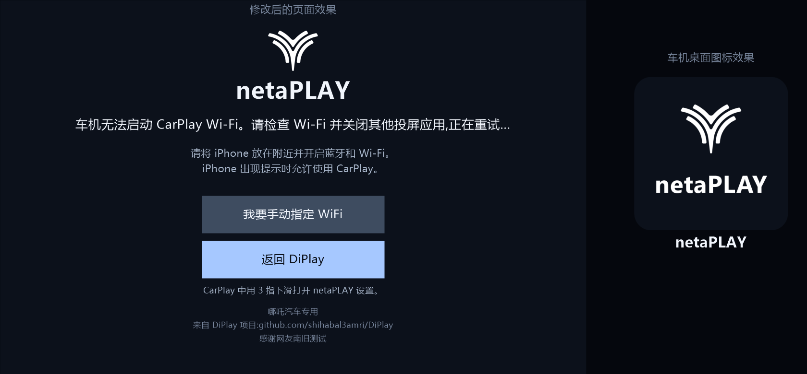

# netaPLAY — 哪吒车机无线 CarPlay

netaPLAY 是面向**哪吒(NETA)车机**的无线 CarPlay 投屏应用,基于开源项目
[DiPlay](https://github.com/shihabal3amri/DiPlay) 深度定制:哪吒车机显示适配、中文界面、
netaPLAY 品牌(哪吒车标)以及一系列真机问题修复。



## 目录结构

```
E:\PLAY
├── APK\netaPLAY_v1.0_20261005.apk   可直接安装的 APK(debug 签名,含 MFi 认证)
├── source\                          完整源代码(Gradle 工程,已排除构建产物)
├── docs\                            预览图
└── README.md                        本文件
```

## 硬件与系统要求

- 哪吒车机(NETA L / HZEP32,15.6 寸分屏系统),Android 10+
- iPhone:iOS 17 及以上(无线 CarPlay)
- 车机需支持 Wi-Fi P2P(5 GHz 优先)或车载热点

## 安装与首次设置

1. 将 APK 拷贝到 U 盘或通过文件管理器安装(允许安装未知来源应用);
2. 首次启动会自动应用**哪吒专用默认值**(无线直连、H.264、30fps、0.8x 画布、
   显示系统栏、2 指手势、顶部缓冲 3%)——已针对 NETA L 实测调优,无需手动配置;
3. 在系统设置中给 netaPLAY 授予以下权限(**强烈建议全部授予**):
   - **麦克风**:CarPlay 语音(Siri)必需;
   - **位置信息**:无线连接失败时的兜底热点(LocalOnlyHotspot)必需;
   - **附近设备/Wi-Fi**:无线连接必需;
   - **通知**(可选):后台会话通知。
4. iPhone 开启 Wi-Fi 和蓝牙,靠近车机,在 CarPlay 中选择配对即可。

## 打开设置(共 4 种方式)

| 方式 | 操作 |
| --- | --- |
| 长按画面 | 在 CarPlay 画面上**单指按住 1.5 秒**(移动/抬起即取消) |
| 右上角悬浮图标 | CarPlay 画面右上角、原车状态栏下方的 netaPLAY 车标小图标 |
| 主页按钮 | 连接等待页"返回 netaPLAY"按钮下方的"netaPLAY 设置" |
| 多指下滑 | **2 指下滑**(默认;可在设置里改成 2–4 指;哪吒系统占用了三指手势) |

> 修改任意设置后点**保存**,会话会自动重连几秒,新配置立即生效(无需重启应用)。

## 常用设置说明

| 设置项 | 位置 | 建议 |
| --- | --- | --- |
| 分辨率(0.8x/0.6x/…) | 显示 | 保持 **0.8x**;车机解码能力有限,更高分辨率可能卡顿 |
| 物理宽度 | 显示 | **450mm**(15.6 寸实测值);数值越大 CarPlay 图标越小 |
| 隐藏顶栏/底栏 | 全屏 | **保持关闭**;隐藏会导致窗口比例变化、画面出黑边 |
| 顶部缓冲 % | 安全区 | 默认 3%,把 CarPlay 内容从原车状态栏下推,减少误触 |
| 安全区编辑 | 安全区 | 四边拖拽;配合"保存"立即生效 |
| 驻车视频 | 音频路由与视频 | P 挡时 iPhone 视频(如 Safari 网页视频)在本屏播放 |
| 音频路由 | 音频路由与视频 | 媒体/导航声道(0=自动)、音频焦点、缓冲、P2P 信道 |
| 调试日志 | 诊断 | 排查问题时打开;日志写入 `/sdcard/Netamade/Xlog/diplay.log` |

## 语音(Siri)说明

- 点 CarPlay 界面内的 Siri/麦克风图标后,**对着车机说话**即可——车机麦克风经
  netaPLAY 编码回传 iPhone;
- 需要授予麦克风权限;
- 方向盘语音键可能被哪吒原车语音助手优先接管(系统行为);
- 若 Siri 听不到声音,打开调试日志后重试一次,把 `Netamade/Xlog/diplay.log` 中
  `Microphone:` 开头的行反馈给开发者(日志会区分"静音被压制"与"正常采音")。

## 已知限制

- 原车状态栏区域属于哪吒系统,点击/下滑仍会拉出原车下拉菜单(任何应用均无法拦截);
- 受 FairPlay 保护的视频(如 Apple TV+)无法在驻车视频中播放(AirPlay 协议限制);
- Wi-Fi P2P 在断线后偶发 `busy`,需等待重试周期或短暂关闭再打开无线开关;
- 调试签名的 APK 覆盖安装会保留设置;卸载重装会清除配对记录,需与 iPhone 重新配对。

## 从源码构建

```powershell
# 需要:JDK 17、Android SDK(API 35);MFI 认证文件放在认证目录的 offline-mfi/ 下
# (identity.pk8 + certificate.p7b)
$env:DIPLAY_AUTH_ASSETS_DIR = "E:\PLAY\auth_assets"
cd E:\PLAY\source
.\gradlew :automotive:assembleStandaloneDebug -x lint
# 产物:automotive\build\outputs\apk\debug\automotive-debug.apk
```

## 致谢与许可

- 上游项目:[DiPlay by shihabal3amri](https://github.com/shihabal3amri/DiPlay)(及其上游
  AirPlay/CarPlay 开源实现),本项目遵循其原始许可证(见 `source/LICENSE`);
- MFi 认证组件仅用于个人与研究用途,请遵守当地法律及 Apple 相关条款;
- 本项目与 Apple、哪吒汽车(Hozon)无官方关联。
